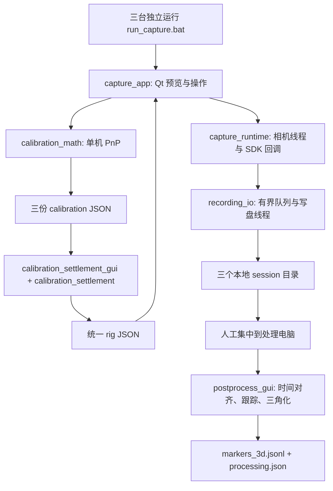

# 软件架构与实现状态

## v8.4 压缩保存和历史录像检查（2026-10-18）

默认 balanced 采用 RGB H.264 MP4＋IR FFV1 无损 AVI；可选三路有损 MP4。video_encoding 封装随固定依赖提供的 FFmpeg，使用每流隐藏子进程和原有独立队列。保存结束检查进程退出、容器帧数和首中尾解码，并把大小、时长和检查范围写入 summary。video_tools / video_tools_gui 提供已有 session 的索引核对、可选逐帧解码与 MP4 副本导出；工作台有统一入口。reconstruction 保留 MP4 源视频。详情见 [v8.4 录像压缩与播放](v8.4录像压缩与播放.md)。下方 v8.3 默认未压缩格式为历史行为。

## v8.3 独立视频写入与录制测速（2026-10-18）

旧 `SessionWriter` 的 96 项图像/IMU 混合队列替换为每路视频独立队列与线程、独立 IMU/帧索引队列。视频缓存按图像字节限制，默认 256 MB；元数据队列不保存图像。编码线程只负责单路视频，完成编码后才将索引交给元数据线程，停止时先排空视频、再排空元数据，最后核对 AVI 帧数与已接收/已写计数。失败保留原始数据并标记不完整。

默认录制方式为快速无损：IR Y800、RGB RGBA 原始 AVI，避免 FFV1 的高编码开销。仍可选择三路 FFV1。分辨率、帧率和像素精度不自动降低；默认快速模式约需 166 MB/s、10 GB/分钟，界面明确占用取舍。`recording_benchmark` 在用户所选目录后台做短时三路写入/回读、检查排队趋势，并刷新操作系统写缓存。实时健康和最终 summary 包含逐路写入耗时、峰值缓存、错误类别与拒绝样本，不再把所有积压都称为磁盘太慢。

空间查询在 SDK 回调锁之外，低空间停止后排空已接收数据。`capture_runtime` 不在回调中做编码或磁盘测试。已有位姿戳、录后三机结算、三路独立音视频保存和原始标定文件兼容性保留。具体复现、格式选择与测试见 [v8.3 录制积压修复](v8.3录制积压修复.md)。

## v8.2 本机标定后录制、汇总时结算（2026-10-18）

当前流程：本机标定 → 直接录像并保存位姿戳 → 本机重建 → 汇总时按帧结算三机关系与融合。替换旧的录制前 rig 门禁；以下历史章节中要求采集前完成三机结算的描述不再适用。

`capture_app` 和 `capture_runtime` 只要求有效本机标定。`SessionWriter` 冻结本机标定快照，写出 `calibration.json` 与 `pose_stamps.json`，视频帧记录时间戳、位姿编号、IR1 相机中心和有效性。标定对象重新保存不会修改已有录像中的快照。`pose_stamps` 校验编号摘要、坐标变换及序列号。

`reconstruction` 保留原始帧的位姿编号；合成在时间配准后按每帧引用的位姿组合调用录后结算，缓存相同组合的结果，并用对应变换进入固定标定板坐标系。输出逐帧 `pose_stamp_ids` / `rig_id` 和 `rig_calibrations.json`。自动录后结算使用独立 schema，保留文件、矩阵、非共面、模型和误差检查，明确固定标定板假设，不伪造人工几何验收。旧版单一位姿后处理也支持无预结算录像。

当前采集按固定机位使用本机标定位姿；IMU 运动报警后标记位姿失效，原视频继续保存。合成支持按帧切换已记录的位姿快照，但采集端尚不根据画面持续重估移动机位。原模型坐标原点保持不变，IR2/RGB 由设备外参与 IR1 联系。

## v8 模型对点引导（2026-10-18）

`capture_app → calibration_wizard → calibration_guidance → calibration_math` 替换原采集窗口的分散手工对点控件。模型和点位基表不变；引导先取正面四角和一个侧翼的上下两点，点击吸附、自动前进，可撤销和重选。核心求解仍使用原 RealSense 去畸变与 PnP / 误差检查，补充贴片面朝向检查以拒绝背面解。新标定继续由既有三机结算流程验证。

`ImageView` 显示候选亮点、确认点及标为“预计”的投影提示，支持标定窗口的缩放与放大镜；预览叠加不进入录像。新 `assets/calibration_target_70.png` 为原模型参考图，点号位置由原始 JSON 生成。详细交互、验证和实际边界见 [v8 模型对点标定](v8模型对点标定.md)。

## v7 启动与交付更新（2026-10-18）

统一链路：`启动数采.bat → start.bat → tools/bootstrap.ps1 → launcher.py`。启动器使用 Python 官方完整 Windows x64 ZIP（非嵌入版），按固定 SHA256 校验并解压到 `.runtime/python`，再创建 `.venv` 安装锁定依赖；不依赖机器 PATH 中的 Python / Conda。离线包将运行包和全部 Windows CPython 3.12 wheel 随包提供。环境失败可以重试，失效环境移至 `.runtime/backups`，数据目录独立保留。

`launcher.py` 提供工作台和四个工具入口，每个工具为独立进程，通过本地命名管道避免同目录同功能重复打开。工作台在子窗口运行时保留，避免退出时终止写盘。由工作台打开的采集与独立离线重建互相限制并行；采集窗口原有的离线入口继续遵守录像状态限制。三机结算仍可独立打开。没有新增远程控制或硬件同步能力。

`tools/environment_check.py` 在独立进程检查固定依赖、Qt 插件、FFV1 回读、目录写入和配置，并枚举相机与麦克风。设备缺失只作为提示，不阻止离线使用；枚举不代表设备权限、吞吐或同步实测通过。日志在 `logs`；自动检查脚本集中在 `tests`，统一由 `tools/run_checks.py` 调用。发布由 `tools/build_release.py` 按明确文件清单构建，排除用户数据和本机环境。

v7 沿用 v6 采集重建算法，新增支持配置 `output_root` 作为采集窗口默认保存位置。`recording_io` 在保存后核对 AVI 头部帧数与记录数，拦截 OpenCV 编码失败却不抛异常时的错误完成标记；这不是逐帧解码校验。当前使用与排障说明以 `software/README.md` 为准。

## v6 更新（2026-10-18）

当前源码与发布包已升级 v6。以下编号章节保留 v5 整理时的架构核查，涉及“尚未实现”的描述以本节和 `software/README.md` 为准。

采集路径：`capture_app → capture_runtime → recording_io + audio_io`。每台一相机一音轨；音频保存 ADC 时间与本机单调时钟映射。`sync_health` 汇总三路收帧状态，不把模式回读冒充线缆连接检测。IMU 在启动至关闭全过程写 telemetry，录像段同时写 CSV。

新处理路径：`reconstruction_gui → reconstruction → stereo_geometry + audio_alignment`。单机六自由度几何使用设备出厂双目外参；SDK 旋转数组按列优先恢复，单位换算为毫米。IR1/IR2 被动双目校正、SGBM 左右一致性和亮点三角化，RGB 按出厂外参映射颜色。三个本机结果按已结算 rig 的逆变换进入 target 坐标；音频分窗口相关和一致性拟合估计时差及速率差，再结合各机 ADC/视频时间映射配帧。可额外使用两个共同视频事件校正视频时间。

新输出为 `result.json`、`frames_3d.jsonl`、NPZ 点云/本机深度图、三条独立对齐 WAV 和全部原始源数据副本。`markers` 保留观测点，`display_markers` 用于平滑及不超过 200 ms 的短时补全。回放为可旋转彩色点云及轨迹，无逐点估计标签，不含人脸蒙皮或音频播放。没有增加局域网远程开停。

IMU 运动报警使用主机单调时间对应视频；报警后保留单机重建，但停止将该机位纳入固定外参融合。缺少 IMU 会在结果记录 checked=false。没有可靠平移补偿。三机自动几何轨迹编号尚不能作为永久解剖点身份。

录像中已锁定标定编辑、处理任务与麦克风选择；错误退出将录像标为不完整。新增 `check_reconstruction_v6.py` 覆盖已知尺度/畸变、RGB 红色、无纹理拒绝、音频正负偏移及漂移、三份 session 重建融合、九路原始视频保留和回放界面；既有检查继续执行。测试不覆盖真实相机吞吐、实际曝光同步与人脸测量精度。

## v5 整理时核查记录

核对对象：`software/`，源自 `D435I_ThreeHost_v5.zip`；核对日期：2026-10-18。本文件区分现有实现与后续设计，不把界面按钮视为现场验证结果。

## 1. 系统边界

三台 Windows 电脑各接一台 D435i，每台运行完全相同的 Qt5 程序。USB 负责本机 RGB、双红外和 IMU 数据；9-pin 线用于设置的硬件同步模式。当前没有 TCP/UDP 服务、在线机位注册、远程开始/停止、自动分发标定或跨电脑就绪检查。

Master/Slave 是相机硬件同步角色，不是软件服务器/客户端。每台计算机的单调时钟独立；网络连接与相同 rig ID 都不能证明曝光同时发生。RGB 与红外的同步关系也不能仅凭角色名称确定。



## 2. 模块职责

| 文件 | 现有职责 | 关键依赖/边界 |
| --- | --- | --- |
| `capture_app.py` | 三画面预览、紧凑状态条、角色按钮、存储目录、冻结 IR1 标点、标定/rig 加载、录像操作 | Qt 主线程；直接调用 RealSense 反投影；复用 ImageView 给后处理 |
| `capture_runtime.py` | 查找设备、拒绝 USB 2.x、启流、配置并回读同步模式、emitter 控制、视频/IMU 回调、录像命令 | QThread + SDK 回调；队列处理命令；锁保护预览快照和 writer |
| `recording_io.py` | FFV1 无损 AVI、逐帧元数据、IMU CSV、完成报告 | 独立写盘线程，队列上限 96 个样本；溢出停止接受并记录错误 |
| `calibration_math.py` | 非共面点 PnP RANSAC + LM、位姿求逆、已匹配观测的三角化 | NumPy/OpenCV；毫米坐标、归一化像点 |
| `calibration_settlement.py` | 三份标定格式、误差、模型一致性检查；相机中心、两两变换、基线、摘要 ID | 不读取新图像，不做联合优化或独立精度验收 |
| `calibration_settlement_gui.py` | 选择三份 JSON、展示结果、人工确认、保存 rig | 用户确认标定物未动及几何符合实物；不是自动机位检测 |
| `postprocess_gui.py` | 加载 session、选两次共同事件、人工指定同名点、光流跟踪、三角化导出 | 处理线程；目前只使用各机 IR1，尚未用 IR2/RGB 重建 |
| `capture_config.yaml` | 统一 1280×720@30、默认 emitter 关闭等设置 | 并非所有字段都已消费，见下文 |
| `check_*.py` | Qt/录像回读、合成几何、结算文件、合成三路后处理检查 | 离线测试，不是硬件同步或实际采集精度证明 |

保持应用内平铺结构是为了让同一目录直接复制运行；这次没有为了分层而改变 Python 导入或 Qt 行为。后续优先将通用 ImageView 从 capture_app 分离，以避免后处理反向依赖采集界面。

## 3. 采集时序与线程

界面选择角色后才能开启相机，开启期间角色按钮锁定。运行时按序列号排序选择首个设备，因此该包的设计前提是每台电脑只接一台相机；配置里的 `serials`、`expected_cameras` 不能视为已实现的设备绑定策略。

设备启用 RGB BGR8、IR1/IR2 Y8 和加速度/陀螺仪流。IMU 频率从设备公布的 profile 中选择接近 200 Hz 的值。SDK 回调复制图像，记录设备时间戳、时间域、主机单调/墙上时间、帧号；只保留最新图像供 UI 每 33 ms 刷新。写盘不依赖 UI 刷新频率。

录像请求经 worker 队列再次验证三机 rig 与本机位姿摘要，必要时自动关 emitter，再创建 SessionWriter。写盘失败或队列溢出通过 error/summary 报告。`complete=true` 只表示写盘流程未报错，仍须检查 `frame_number_gaps`；不能等同于“无丢帧”。

默认目录由 capture_app 的程序目录生成；`output_root`、`session_id` 目前未形成统一受试者/任务数据管理。真实会话目录名为时间加设备序列号。

## 4. 坐标与标定

坐标基准是打印标定物；不是人脸中心，也不是 Master 相机。采用列向量：

```text
p_camera_i = T_camera_i_from_target · p_target
T_target_from_camera_i = inverse(T_camera_i_from_target)
T_camera_i_from_camera_j = T_camera_i_from_target · inverse(T_camera_j_from_target)
camera_center_target = -Rᵀ · t
```

平移和输出点位单位为 mm。SDK 内参反投影得到归一化视线。每台冻结 IR1，点击已知 ID 的贴片中心，至少六点且非共面；RANSAC 后再 LM 优化。当前门槛为 RMS ≤1.5 px、最大单点误差 ≤3 px。

点位来自 `points_blender52_final.json` 的原始基表，运行时应用 `position × 0.70 − normal × inset`，默认 inset=0.55 mm。该 JSON 不能直接当作 70% 成品的实际反光面坐标；文件里的旧槽深描述与修正模型存在历史差异，精度评估需以实际打印件尺寸及贴片厚度为准。

三机结算检查序列号唯一、模型/缩放/内缩一致、同名点三维坐标一致、旋转与逆矩阵、已保存的重投影误差；计算机位中心、基线与相对转角，生成 rig ID。基线超出 80–2500 mm、光轴偏差过大等是警告，不全部构成硬拒绝。未确认两个复选框则不放行。

**结算并未重新使用 `image_points` 计算重投影，也没有独立验证图像、跨相机公共点重建误差或 bundle adjustment。** 人工勾选、摘要一致和三个文件各自误差小，不能证明打印比例正确、标定物没有移动或点号完全正确。当前阶段应称为“文件及几何预检”，不是自动精度认证。

rig ID 由标定摘要、序列号及导入 slot 决定；调换导入顺序可能改变 ID。因此必须生成一份后分发，不能三台各自重新结算。哈希用于一致性检查，不是签名认证。

## 5. 数据接口

| 文件 | 内容与消费者 |
| --- | --- |
| `calibration_<serial>_<time>.json` | 单机位姿、内参、点号、三维点、图像点、误差；交给结算工具 |
| `rig_calibration_<id>.json` | 三台完整标定、相对位姿、人工确认和 rig ID；分发到采集端 |
| `session.json` | 本机流规格/内外参、serial、sync_role/mode、emitter、单机与整套 rig |
| `<serial>_rgb.avi` | FFV1 彩色视频；写入 BGR，显示时转换 RGB |
| `<serial>_ir1.avi` / `ir2.avi` | 两路 FFV1 灰度原始录像 |
| `frames.jsonl` | 每帧设备/主机时间、帧号、分辨率、可用曝光增益、对应视频文件与索引 |
| `imu.csv` | accel/gyro、时间域、设备/主机时间、x/y/z，单位 m/s² 或 rad/s |
| `summary.json` | 完成标记、写盘错误、各流样本数、帧号缺口 |
| `markers_3d.jsonl` | time_ms、marker_id、xyz_mm 或 null、来源机位/帧/像点、status |
| `processing.json` | session 路径、时间锚点、初始点号、rig ID、角色、机位关系、IMU 异常时间 |

每份 session 包含整套 rig 是为了后续可追溯。不同电脑的 `host_monotonic_ns` 不能直接相减。RGB/IR2 只是已存档；“采集了九路视频”不代表“九路都完成时空重建”。

## 6. 后处理实际行为

三份录像先检查 rig ID 和角色是否匹配；每台手选前后两个共同事件帧，用设备时间拟合偏移和线性速率比。匹配后允许最大 5 ms 时间差；自由运行的 30 fps 视频即使选了事件，也可能因曝光相位不同大量超限。

用户在各机 IR1 中指定同一 Mark ID 的初始像点。LK 光流正反向检查和局部亮点质心细化跟踪；遮挡丢失后没有自动重识别。至少两机有效、最佳交会角 ≥1°、回投影误差 ≤3 px 时输出三角化点，否则写入无效状态，不填造数据。

IMU 仅在时间域可比较时，以陀螺仪模长 >0.05 rad/s 或加速度模长偏离重力 >1 m/s² 记录运动报警；从首次报警起排除该机位。没有静态平移补偿、视觉惯性融合或自动重新标定。时间域不匹配时检查会跳过，故不能将没有报警视为支架未动的证明。

## 7. 待完成的工程闭环

| 优先级 | 当前缺口 | 应形成的验证结果 |
| --- | --- | --- |
| 高 | 三机结算没有独立观测验收 | 保留独立公共点图像，采集前计算回投影/重建误差及重复标定稳定性；核对实物尺度 |
| 高 | 无局域网统一控制 | 注册 serial/角色/rig ID，三机 ready 后统一试录与开停；保存每机回执；不宣称网络命令即曝光同步 |
| 高 | 没有现场同步验收 | 9-pin 接线和不同流实际曝光事件测试；量化 IR/RGB 偏移与漂移 |
| 高 | 运行状态门禁分散 | UI 与 worker 使用同一状态机；录像期间锁定求解/加载标定，避免显示状态与已写 session 分离 |
| 中 | 几何验证不完整 | 严格检查 NaN/Inf、畸变参数、图像观测与 model hash；明确误差阈值依据 |
| 中 | 标点和遮挡恢复依赖人工 | 用真实录像测 ID 交换、丢点、重识别与三维误差，决定是否联合六路 IR |
| 中 | 配置与可复现性 | 统一实际使用的配置字段、固定测试过的依赖版本、增加每次采集的完整环境清单 |

这次整理保留上述实现，没有把架构建议悄悄替换为新算法。已有自动检查验证软件逻辑和合成数据，不覆盖真实 D435i 带宽、曝光同步、照明、打印件精度与受试者数据质量。
